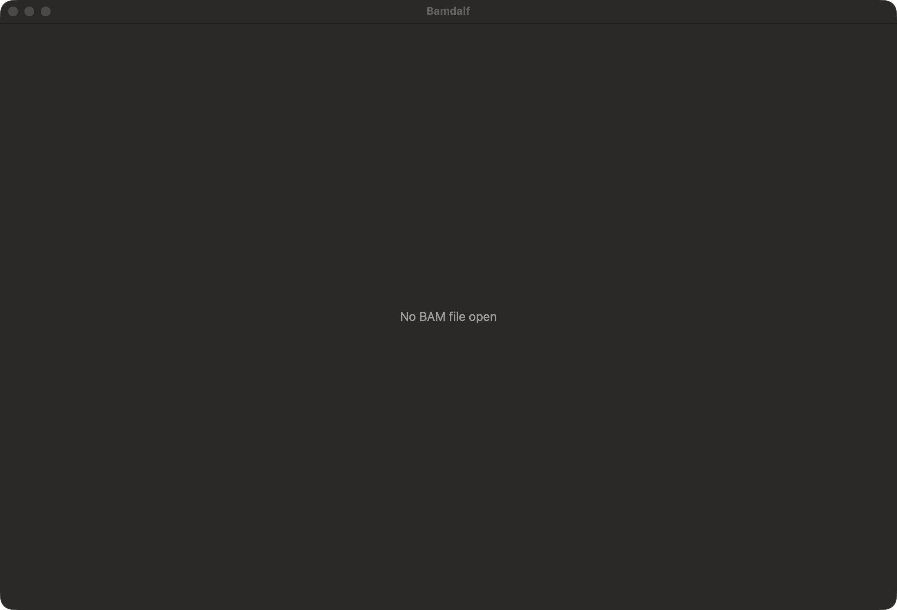

# Native development

## Prerequisites

Use an Apple Silicon Mac running macOS 15 or newer, with Xcode 16.4 or newer
and its macOS SDK. Open Xcode once and complete its license agreement and
component installation. These setup steps require the developer's acceptance;
a successful `xcodebuild -version` alone does not prove setup is complete.

Select the installed Xcode for the current shell without changing the system
selection:

```sh
export DEVELOPER_DIR=/Applications/Xcode.app/Contents/Developer
xcodebuild -version
swift --version
```

CI uses the Apple Silicon `macos-15` runner and explicitly selects
`/Applications/Xcode_16.4.app/Contents/Developer` (Swift 6.1). The runner and
installed Xcode version are described in GitHub's
[runner documentation](https://docs.github.com/en/actions/how-tos/write-workflows/choose-where-workflows-run/choose-the-runner-for-a-job)
and [macOS 15 image inventory](https://github.com/actions/runner-images/blob/main/images/macos/macos-15-arm64-Readme.md).

## Build, test, and launch

From a fresh checkout:

```sh
bash scripts/build-htslib.sh
swift build
swift test --disable-xctest
bash scripts/build-app.sh
open .build/Bamdalf.app
```

The script builds the release executable, packages its native application bundle,
and applies an ad hoc signature for local use. No paid Apple developer account
is needed. This is a development app, not a notarized distribution.

The launch window contains a full-width workspace with **No BAM file open**.
Use **File → Open BAM…** / **Command-O** to select a local BAM. The app discovers
`sample.bam.bai`, `sample.bai`, `sample.bam.csi`, and `sample.csi` beside
`sample.bam`. One candidate opens automatically; multiple candidates require an
explicit choice. Canceling or failing a replacement preserves the open session.
An index failure identifies the selected file without trying another index.

A successful open shows **Enter a genomic interval** and focuses the field.
Enter a complete 1-based inclusive interval, for example `tiny:100-200` with
the opening fixture. Enter validates against the BAM header, formats the field,
and moves the ruler. Malformed or out-of-range input remains editable with an
inline error; editing clears the error without navigating. **Go → Go to
Interval** / **Command-L** focuses and selects the existing text. **Escape**
in the editor restores the target coordinates (or clears it before navigation).

This increment navigates coordinates but does not query or draw regional
alignments. It explicitly shows **Alignment viewing is not available yet**
instead of claiming an empty result. There is no permanent file sidebar or Open
BAM toolbar button. Close the window or use **Bamdalf → Quit Bamdalf** /
**Command-Q** to quit.

For a focused check while developing:

```sh
swift test --disable-xctest --filter LaunchTests
```

Run the documentation checks in [CONTRIBUTING.md](../CONTRIBUTING.md) as well.

## Implementation and test boundary

Swift 6, AppKit, and Swift Package Manager supply the native application, window,
build, and tests. A narrow C adapter uses source-built **HTSlib 1.25** behind an
actor that owns the BAM, header, and selected index. This is an internal app
boundary, not a public SDK. Header/index loading runs off the main thread, and
obsolete open attempts cannot replace a newer session or show stale errors.

`scripts/build-htslib.sh` downloads the official
[HTSlib 1.25 release](https://github.com/samtools/htslib/releases/tag/1.25), verifies
its pinned SHA-256, and builds a static library for macOS 15 or newer. The first
build needs network access; subsequent builds reuse the verified archive and
toolchain-specific build. Optional networking, plugins, libdeflate, bzip2, and
LZMA are disabled for this local-BAM scope. The app links system zlib and copies
the upstream HTSlib/HTScodecs licenses into its bundle. It needs no Homebrew
libraries or runtime samtools executable. Run the dependency script again after
cleaning `.build` or changing Xcode. CI runs the same script before Swift builds.

`ViewerSession` owns the application-facing presentation consumed by the real
native workspace. Swift Testing checks that seam and the actual AppKit window.
Native checks inspect the visible message, workspace sizing, field focus after
real opening, selectable index-menu items, explicit choice, and the attached
selected-index error alert. They exercise the file-selection completion action
used by the actual native chooser. Integration checks use the
production reader and small real BAI/CSI files through the session. Controlled
completion tests deliver older results after newer opens without timing sleeps.
These checks do not claim regional alignment rendering or WGS performance.

Interval tests drive editing/submission/reset through that same session with
real header bounds. Native tests send Enter/Escape through the actual AppKit
field editor, exercise the real Go menu, and inspect inline errors and ruler
labels after focus changes and window resizing. The ruler places full integer
labels at base centers, choosing 1/2/5 steps and reducing density to fit. Targets
use signed 64-bit, 1-based inclusive coordinates; BAM query conversion belongs
to the later regional-reader increment.

The readable opening source fixture is
[`opening.sam`](../Tests/BamdalfKitTests/Fixtures/opening.sam). Its references are
`tiny` (2,000 bases) and `other_reference` (800 bases), with 10-base and 6-base
alignments at positions 101 and 201 respectively. The
[`coordinates.sam`](../Tests/BamdalfKitTests/Fixtures/coordinates.sam) fixture
adds a 300,000,000-base reference and an exact reference name containing a colon
and hyphen. Regenerate both fixtures' committed BAM, BAI, and CSI files using:

```sh
bash scripts/generate-fixtures.sh
```

Opening validates format/header and loads the explicitly selected index. It
does not scan all alignments, verify complete sorting, or guarantee detection of
every stale/mismatched index. No reference FASTA is required.

The `Native macOS` CI job builds, runs the tests, and packages the application.
`Required checks` depends on both native and documentation jobs and accepts
only successful results. All three jobs must be required by branch protection
before this bootstrap can merge.

## Native demonstration

On 2026-11-07, the packaged release app was launched on Apple Silicon macOS
27.2, built with Xcode 27.2 / Swift 6.4.2. The native accessibility tree exposed
the Bamdalf window, its message, standard window controls, and Bamdalf/File/Window
menus. **Command-Q** terminated the app. Both automated session/window tests
passed locally, including workspace resizing. CI independently exercises Xcode
16.4 / Swift 6.1.2 on macOS 15.



On 2026-11-07, manual use reached the native index chooser and exposed disabled
BAI/CSI choices. A native regression reproduced both disabled menu items and an
ineffective selection. The controller's menu validation had applied its
"window has a sheet" restriction to the popup choices as well as File → Open
BAM. Restricting that validation to the File command restored the native popup
actions. The regression verifies both candidate items remain enabled, no index
is preselected, an explicit CSI selection enables Open, and the File command
stays disabled while the chooser is attached. A separate native check verifies
the selected-index error alert and preservation of the previous workspace.

On 2026-11-07, native interval tests demonstrated valid, one-base, out-of-range,
malformed-comma, and unfinished-edit cases using real BAM header lengths.
They retain the target ruler across rejected/unfinished text, keep errors on
focus loss, and use the actual menu/field-editor actions for focus and Escape.
Optional PNG evidence comes from those same AppKit windows, not a mockup:

```sh
BAMDALF_NATIVE_CAPTURES="$PWD/.local/validation/native-intervals" \
  swift test --disable-xctest --filter NativeIntervalTests
```
