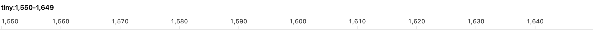
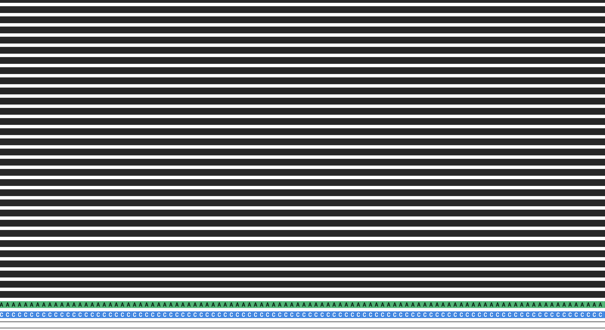
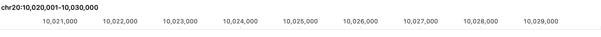
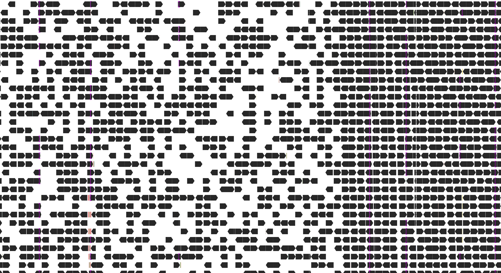

# Integrated prefetch qualification, 2026-11-11

The production configuration with prefetch enabled met every measured timing and
memory target in the frozen protocol. The disabled engineering comparator missed
the original-dense 10 kb small-drag target: 108/120 updates finished within 33 ms
(90%; p95 34.639 ms), versus 117/120 with prefetch enabled (97.5%; p95 32.510 ms).
All 62 native cases completed, but **the combined all-mode result remains
`qualified=false`**. The separate `production_configuration_meets_targets=true`
field describes the shipping configuration; it does not erase the comparator miss.

[Issue #36](https://github.com/micknudsen/bamdalf/issues/36) requests supported
internal defaults for the completed feature and a disabled/enabled comparison.
The [parent feature](https://github.com/micknudsen/bamdalf/issues/32) ships prefetch
enabled without a user-facing toggle. This report applies the unchanged acceptance
targets to that production configuration and reports the disabled comparison's
failure explicitly. No target was relaxed and no disabled behavior was tuned to
change the aggregate result. Final Spec review and delivery gates are separate
from these completed measurements; their status is recorded below.

## Protocol, source, and metric boundaries

The [frozen protocol](prefetch-qualification-protocol-2026-11-11.md) defines 31
paired workloads, complete source bounds, input pins, native event routes, timing
boundaries, and thresholds. Its SHA-256 is
`cd18bdd8ea6dcc54d3253b1061aaf9c96aa65862b5d9f30c0844bf1a561c6aad`.
Measurements used clean harness commit
`255891c8ca7006e8bfe8a00299f92fa2e18941cf`; every production source file matches
merged feature baseline `12187b1f740e0fc00fffe59a40e8c3493877b2a2`.
The executable SHA-256 is
`d584fa562479eaf4109eb8a2c5f69c349db75d57c80f23d427c0427472d22aae`.

The recorded environment was Apple M4, arm64, 16 GiB RAM, macOS 27.2 (26B123),
Xcode 27.2, Swift 6.4.2, and static HTSlib 1.25. The release executable used light
appearance, a 1,100 × 720-point window, seed 42, the 2,000-group display budget,
and the 10 kb alignment-visible cutoff. Collection started at
2026-11-10T23:12:26Z, which is 2026-11-11 00:12:26 in Europe/Copenhagen.
The [environment](data/prefetch-qualification-2026-11-11/environment.json) and
[source, executable, dependency, and input hashes](data/prefetch-qualification-2026-11-11/sha256.json)
preserve the actual baseline.

Each case ran in a separate process without competing builds/tests. Fresh-load
cases used 20 fresh application sessions inside that process. Checksum reads and
prior observations warmed OS file caches; these are app-uncached measurements,
not cold-storage measurements. Pair order alternated between workloads.

Timing starts before native input handling and ends after required readiness,
native layout, and synchronous bitmap drawing by the actual alignment and ruler
NSViews. There is no optional-settling pause before first drawing. Ready time and
raster time are separately retained. PNG encoding, validation, logging, and route
cadence waits are excluded. Native button action dispatch excludes synthetic
button highlighting; pointer and wheel events call native handlers. OS event-queue
delivery, compositor presentation, and input-to-photon latency are not measured.
Readiness polling can add approximately 1 ms.

Targets remain at least 95% within 500 ms for ordinary loads, 1,000 ms for dense
loads, 100 ms for query-free navigation, and 33 ms for drag/scroll updates; peak
process RSS must remain strictly below 2 GiB. A pan with a required query retains
its ordinary/dense load target. A pan without a required query receives the
100 ms target even if optional work runs. The summary evaluates each case and
action/target class separately: 77 enabled groups passed; 79/80 disabled groups
passed. Nearest-rank p95 and the within-target fraction are reported without
pooling easy and difficult cases for acceptance.

## Complete inputs and observed routes

The [data recipe](../../Benchmarks/Data/qualification-README.md) supplies the
expanded HG002 derived approximately 100× panel and the complete unsampled
original nominal 300× source. Preparation sampling of complete exact RG/QNAME
fragments is distinct from runtime display sampling. Neither input receives a
second benchmark subsample or a required-query prefix cap.

| Input | BAM SHA-256 | Use |
| --- | --- | --- |
| `HG002.GRCh38.qualification-100x.bam` | `b5282123828cc68e0048e6c17809e0e811e6cb70b62429018e0fb6119b9aee33` | Ordinary A/B and derived dense |
| `HG002.GRCh38.qualification-source.bam` | `d2c2aba71c005d7b8e8b69841566475ae2c4418105deba15b4d11fa1697b6d08` | Original dense and sustained memory |

Both inputs cover complete aligned-span extraction intervals
chr20:9,830,401–10,354,688, chr20:19,988,481–20,119,552, and
chr20:29,818,881–30,081,024. Their individual BAI pins, synthetic fixture pins,
and reference dictionaries are retained in the protocol. The small historical
original-dense slice was not used for 10 kb routes. The wholly known rows,
rolling-tail, and 10,000-record large-group fixtures supplement HG002; they do
not represent biological depth or WGS performance.

[Preflight](data/prefetch-qualification-2026-11-11/coverage-audit.json) passed 6,374
conservative presentation audits, including full desired C rather than just the
viewport or required R. A negative probe rejected the old memory target whose C
began below the complete extraction; the frozen route uses an interior target.
During collection, the native harness checked every actual required/optional
query and presented C against complete source bounds.

The independent [observed-route audit](data/prefetch-qualification-2026-11-11/route-audit.json)
checked all 18,212 recorded events against input order, original drag anchors,
fractional positions, release coordinates, pan/zoom transforms, reference limits,
and actual scrolling. Maximum effective-position error was
5.684341886080802e-14 bases, below the 1e-6-base tolerance. The postprocessing
[auditor](../../Benchmarks/PrefetchQualification/audit.py) has SHA-256
`db2b61c4c4255e87cfcb6733683d7864a4e2989e5821f2af0b81f7278aa7b176`.
It was added after the timing source freeze and did not change measured execution.

## First ready and drawn, cached navigation, and small motion

All 20 fresh-session observations in every load case met their declared target.
Times below are milliseconds; D/E means disabled/enabled. First is the first
ready-and-drawn observation, while median ready/raster shows the separate
boundaries. Medians of components need not sum to the median total.

| Input and width | First D/E | p95 D/E | Median ready D/E | Median raster D/E |
| --- | --- | --- | --- | --- |
| Ordinary A, 1 kb | 96.15 / 58.39 | 54.50 / 39.04 | 20.84 / 21.08 | 6.27 / 5.93 |
| Ordinary A, 10 kb | 72.67 / 73.39 | 56.93 / 52.76 | 42.71 / 42.42 | 8.46 / 8.49 |
| Ordinary B, 1 kb | 23.48 / 23.32 | 32.53 / 33.01 | 20.30 / 18.60 | 6.36 / 5.85 |
| Ordinary B, 10 kb | 68.64 / 68.93 | 50.62 / 50.37 | 41.64 / 40.81 | 7.85 / 7.73 |
| Derived dense, 1 kb | 75.18 / 78.49 | 49.65 / 51.63 | 43.40 / 40.50 | 5.05 / 4.96 |
| Derived dense, 10 kb | 90.16 / 84.55 | 82.39 / 84.55 | 59.41 / 60.41 | 7.51 / 7.53 |
| Original dense, 1 kb | 105.45 / 104.68 | 80.67 / 78.72 | 69.49 / 71.48 | 4.47 / 4.48 |
| Original dense, 10 kb | 158.73 / 147.57 | 140.13 / 147.57 | 115.50 / 119.05 | 7.25 / 7.23 |

Cached right/left pans and centered zoom out/in each completed 20 observations
per region and mode without a required query. The largest cached-action p95 was
21.32 ms disabled and 23.13 ms enabled, both in original-dense zoom out, below
100 ms. This does not imply enabled prefetch accelerates already-cached drawing.

| Small-motion view | Drag p95 D/E (ms) | Drag within 33 ms D/E | Scroll p95 D/E (ms) |
| --- | --- | --- | --- |
| Ordinary A, 1 kb | 5.68 / 5.96 | 120/120 / 120/120 | 4.24 / 3.93 |
| Ordinary A, 10 kb | 14.25 / 14.92 | 120/120 / 120/120 | 7.46 / 7.59 |
| Original dense, 1 kb | 13.68 / 13.26 | 120/120 / 120/120 | 3.98 / 3.97 |
| Original dense, 10 kb | 34.64 / 32.51 | **108/120 / 117/120** | 6.62 / 6.70 |
| One 10,000-record group | 9.01 / 9.08 | 120/120 / 120/120 | 3.57 / 3.81 |

Every small-scroll observation met 33 ms. Original-dense 10 kb drag maxima were
39.867 ms disabled and 37.890 ms enabled. Enabled still had three updates over
33 ms; its 97.5% result passes the specified proportion, not an every-frame
promise. The disabled miss remains a measured limitation of that comparator.

The large-group load retained all 10,000 distinct records as one unsampled
group. Its p95 ready-and-drawn time was 505.29 ms disabled and 562.37 ms enabled;
all 20 observations per mode met the designated 1,000 ms stress target. Median
ready/raster was 498.80/1.92 ms disabled and 512.33/2.00 ms enabled. The display
group budget is not a cap on records or retrieval work.

## Sustained rolling pans, reversals, and drag previews

Each view ran five fresh-session routes: eight half-width pans right, eight left,
eight right at a 100 ms period, followed by 32 fractional native drag updates at
a 33 ms period and release. Motion did not wait for optional settling. The table
summarizes 120 pans and ten first-after-reversal pans per mode; acceptance still
uses the separate action/target groups in the full summary.

| Route | Pan p95 D/E (ms) | Reversal p95 D/E (ms) | Query-free pans D/E | Empty drag updates D/E |
| --- | --- | --- | --- | --- |
| Ordinary A, 1 kb | 35.38 / 20.66 | 21.89 / 20.46 | 80/120 / 120/120 | 50/160 / 0/160 |
| Ordinary A, 10 kb | 49.66 / 26.10 | 26.03 / 25.72 | 80/120 / 120/120 | 70/160 / 0/160 |
| Original dense, 1 kb | 95.76 / 29.24 | 27.54 / 27.09 | 80/120 / 120/120 | 50/160 / 0/160 |
| Original dense, 10 kb | 81.92 / 93.20 | 39.14 / 33.04 | 80/120 / 91/120 | 70/160 / 0/160 |

All rolling action groups met their applicable target. Enabled dense 10 kb
query-bearing left pans had p95 128.49 ms and right pans 88.57 ms, under their
1,000 ms target; query-free left/right p95 values were 32.84/40.56 ms, under
100 ms. The maximum enabled rolling drag update was 20.84 ms. Five enabled
releases per view required no foreground query; dense 10 kb release p95 was
26.10 ms, versus 59.10 ms with a required query when disabled.

Enabled drag previews retained alignments throughout these routes; disabled
previews had 240 empty updates out of 640. Empty means no presented alignments,
not an empty underlying BAM region. This difference matters when comparing
rendering costs: the modes did not always draw equivalent content.

| Route | Median returned alignments per session D/E | Peak process RSS D/E (MiB) |
| --- | --- | --- |
| Ordinary A, 1 kb | 4,824 / 8,127 | 179.30 / 180.11 |
| Ordinary A, 10 kb | 36,058 / 70,245 | 216.97 / 212.05 |
| Original dense, 1 kb | 31,604 / 52,278 | 216.05 / 210.81 |
| Original dense, 10 kb | 110,872 / 358,199 | 280.61 / 271.17 |

These counts include setup, required and optional queries, and completed settling
for each session. Repeated retrieval counts repeatedly; interrupted/filtered
native records are not returned alignments. Disabled retains eight snapshots;
enabled uses the 32 MiB optional cache. The comparison includes that retention
policy and additional preview data, not only scheduling overhead.

The dense 10 kb cost remains visible: enabled pan p95 is higher and returned
alignment work is about 3.23 times the disabled value, with lower peak RSS.
The [prior focused report](rolling-prefetch-2026-11-10.md) measured 145.57 versus
107.00 ms pan p95 and 328,176 versus 110,872 median returned records. Its source,
measurement driver, and repetitions differ; the new values do not rewrite that
result or establish a controlled speedup over it.

## Actual-reader foreground priority

A separate archived copy of the final production source was instrumented at the
actual successful native `bamdalf_query_next` return and native iterator closure.
The [probe](../../Benchmarks/AdjacentPrefetch/instrument.py) ran five full-drain
controls and five overlapping interruptions for each 1 kb workload. No production
observer was added, and these instrumented timings are separate from native
ready-and-drawn measurements. [All 30 observations](data/prefetch-qualification-2026-11-11/reader-observations.json),
[summary](data/prefetch-qualification-2026-11-11/reader-summary.json), and
[probe source/input hashes](data/prefetch-qualification-2026-11-11/reader-sha256.json)
are retained.

| Probe | Native records in full drain | Records before interrupted stop | Max request-to-close (ms) | Max foreground ready (ms) |
| --- | --- | --- | --- | --- |
| Ordinary 1 kb | 821 | 25–28 | 0.018708 | 3.803 |
| Derived dense 1 kb | 3,674 | 18–23 | 0.017875 | 11.336 |
| Original dense 1 kb | 10,877 | 23–28 | 0.023292 | 37.828 |

All 15 interruptions canceled active optional reading before its full drain, and
every optional native iterator closed before the first foreground record decoded.
The largest first-record-to-request interval was 0.033 ms. The original-dense
probe uses the historical small complete extraction only for its covered 1 kb
route; the full 10 kb qualification uses the expanded source described above.

Cancellation checks occur between decoded records and during long sequence/CIGAR
work. They cannot interrupt one blocking HTSlib call. Probe callback/locking
adds overhead; the observations establish actual ordering on these inputs,
not a universal storage-latency bound or merely a task-priority assertion.

## Active ten-minute memory traces

Both memory cases warmed the required anchor and settled initial optional work
before starting active duration. Each completed 60 cycles and 6,120 actions:
40 right/40 left pans, disjoint jumps, eviction/reload with matching selected
identities, dense viewing, real scrolling, drag/release, and wide/return transitions.
The raw trace samples resident bytes and physical footprint every 250 ms; the
process-lifetime RSS maximum is independently checked with `/usr/bin/time -l`.

| Metric | Disabled | Enabled |
| --- | --- | --- |
| Active navigation seconds | 604.821417 | 608.821707 |
| Warmup offset seconds | 0.266483 | 0.627479 |
| Recorded memory samples, including warmup | 2,363 | 2,370 |
| Peak process RSS bytes | 344,948,736 | 284,164,096 |
| Peak process RSS MiB | 328.969 | 271.000 |
| Peak sampled resident bytes | 344,719,360 | 284,049,408 |
| Peak sampled physical footprint bytes | 252,527,816 | 180,077,720 |
| Required / optional query calls | 5,101 / 0 | 3,320 / 19,850 |
| Returned required / optional alignments | 63,800,594 / 0 | 42,551,678 / 37,789,332 |
| Process input / output block operations | 0 / 0 | 0 / 0 |

Both peaks are below 2 GiB, as are all other case peaks. All enabled memory-route
action groups met their targets. The [full trace](data/prefetch-qualification-2026-11-11/memory-trace.csv)
and [per-minute ranges](data/prefetch-qualification-2026-11-11/memory-by-minute.csv)
retain warmup, every full minute, and the final partial minute. The resident
floor changes across the run; these finite traces do not establish flat memory,
absence of leaks, or unlimited-session boundedness. Zero OS block operations in
these warmed observations do not mean no logical reading, and no physical-byte
I/O measurement is claimed.

## Native demonstration and selected defaults

Completed native assertions cover typed and toolbar navigation, double-click and
Option-click zoom, sampled/unsampled transitions, ruler-only suppression, actual
scrolling, draft-preserving fractional previews, release, reference limits,
loaded-empty coverage, and required-failure recovery. Recovery restored the prior
successful selection and top-of-stack before an attached alert. That assertion,
not a cropped screenshot, establishes alert presence. The synthetic injected
failure does not establish all malformed-BAM behavior.

The tail workflow starts with 80 alignments; arriving data adds three tails during
the latest fractional preview and yields 83 records on release. The images show
forward A in green, reverse C in blue, and missing sequence as an outline. All
source captures remain archived; the figures below are separate native ruler and
alignment renders, not compositor screenshots of an entire window.









Retain the measured production choices: fixed M = 250 bases; P = max(W, 250);
refill at P/2 contiguous headroom from R; 1,000-base optional chunks; 32 MiB
optional cache; 8 MiB/20,000-native-record optional-query limits; 80 attempts per
demand and 64 failed/backoff ranges. The earlier margin/chunk/threshold comparisons
and these integrated results support those defaults for the recorded workload.
No additional production tuning was needed for the enabled targets. Required
queries remain complete and are never truncated to optional budgets. The dense
10 kb work/latency cost and comparator drag miss limit any broader performance
claim; the defaults do not guarantee smooth panning at every depth or speed.

## Evidence, reproduction, and delivery status

[Per-case summaries](data/prefetch-qualification-2026-11-11/summary.csv) retain first,
median, p95, maximum, counts within target, and separate required/optional calls.
The lossless [18,212 observations](data/prefetch-qualification-2026-11-11/samples.csv.gz)
and [32,147 query events](data/prefetch-qualification-2026-11-11/queries.csv.gz)
retain complete metrics. [Execution completion](data/prefetch-qualification-2026-11-11/execution-completion.json)
confirms every frozen case; [evaluated completion](data/prefetch-qualification-2026-11-11/completion.json)
preserves both production success and the combined false result.

The complete native source snapshot, per-case JSONL, query JSON, resource output,
commands, and original captures remain in
`.local/measurements/issue-36/qualification-v1/`; the uncompressed aggregate is
`qualification-v1-summary-final/`. The separate reader archive is
`.local/measurements/issue-36/reader-priority-v1/`. Pre-freeze smoke archives remain
separate and contribute no authoritative observations. The reader snapshot has
the same production sources; a later Package.swift script exclusion does not
change them. Postprocessing additions receive their own provenance.

With the pinned inputs prepared and the documented native prerequisites met,
use new output directories for each reproduction:

```sh
export DEVELOPER_DIR=/Applications/Xcode.app/Contents/Developer
swift build -c release --product PrefetchQualification
python3 Benchmarks/PrefetchQualification/protocol.py Benchmarks/prefetch-qualification-v1.json
python3 Benchmarks/PrefetchQualification/run.py .build/release/PrefetchQualification Benchmarks/prefetch-qualification-v1.json .local/measurements/issue-36/reproduction-v1
python3 Benchmarks/PrefetchQualification/summarize.py Benchmarks/prefetch-qualification-v1.json .local/measurements/issue-36/reproduction-v1 .local/measurements/issue-36/reproduction-v1-summary
python3 Benchmarks/PrefetchQualification/audit.py Benchmarks/prefetch-qualification-v1.json .local/measurements/issue-36/reproduction-v1 > .local/measurements/issue-36/reproduction-v1-route-audit.json
python3 Benchmarks/AdjacentPrefetch/instrument.py .local/measurements/issue-36/reproduction-reader-v1 1000
```

At this report's drafting point, native measurement collection and audits are
complete. The unchanged local full-suite guard rejected an exit without its final
completion summary; that attempt is incomplete, not a passing full suite.
Its log remains `.local/validation/issue-36-full.log`. Final two-axis review,
a complete native test summary in CI, all required checks on the final PR head,
and the parent acceptance audit remain delivery gates. No merge or complete CI
result is claimed by the measurements above.
