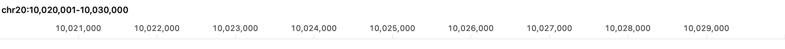
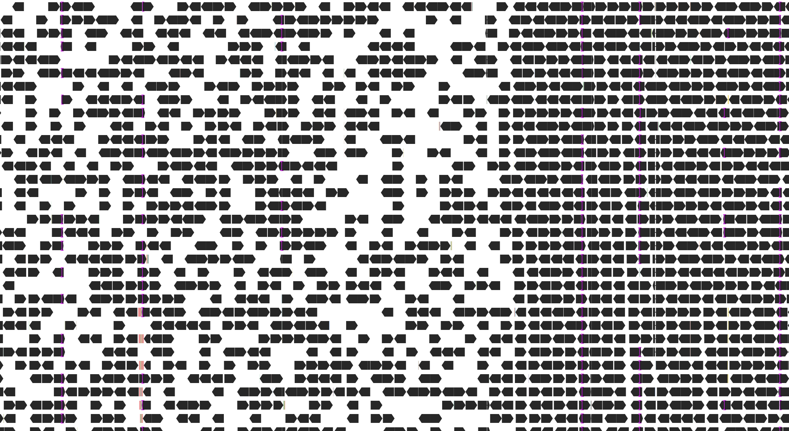

# Native viewer qualification — 2026-11-08

**All 27 protocol cases completed and met their applicable qualification targets**
on the specified Apple M4 with 16 GiB RAM: 25 timing cases, the integrated native
demonstration, and the ten-minute memory route. Peak process RSS was 202,768,384
bytes (193.375 MiB) during 612.701 seconds of navigation. The original 300× dense
10 kb drag case passed with 118/120 updates within 33 ms (p95 30.819 ms); two
updates exceeded the per-update limit. No numerical target or product default
was changed. These are qualification results for the recorded workload and
measurement boundary; protected PR CI remains a separate delivery gate.

This records [issue #11](https://github.com/micknudsen/bamdalf/issues/11) against
the [accepted qualification plan](qualification-plan-2026-11-08.md) and
[locked protocol v2](qualification-protocol-v2-2026-11-08.md). The committed
[observations](data/qualification-2026-11-08/samples.csv),
[per-case summaries](data/qualification-2026-11-08/summary.csv), and
[completion records](data/qualification-2026-11-08/completion.json) accompany
this report. Each case ran in a separate process; results below are never pooled
across ordinary and stress inputs.

## Measured revision and boundary

| Item | Recorded value |
| --- | --- |
| Source revision | [`01d3d9506e88c5e697e688c6a136d90303404f15`](https://github.com/micknudsen/bamdalf/commit/01d3d9506e88c5e697e688c6a136d90303404f15) |
| Optimized executable SHA-256 | `6e5b84ea6a8afa706ecb1056628ceefbad4700f194d707038c72fc53da5f88a5` |
| Protocol | [`qualification-v2-2026-11-08`](../../Benchmarks/qualification-protocol-v2.json) |
| Protocol SHA-256 | `8572de581d646b85c4ea3540ff6bef8edacf1f77ce367216223ef6bac14f3000` |
| Machine | Apple M4, arm64; 17,179,869,184 bytes RAM (16 GiB) |
| Operating system | macOS 27.2, build 26B123 |
| Qualification toolchain | Xcode 27.2, build 27B52; Swift 6.4.2 |
| Dependency | Pinned static HTSlib 1.25 |
| Window | Light appearance, 1,100 × 720 points of content |
| Actual alignment viewport | 1,068 × 584 points, backing scale 2, in every recorded observation |
| Product defaults | 2,000 sampling groups; alignments visible through 10,000 bases |
| Controlled session seed | 42; distinct from preparation seed 20261108 |

The release harness drives the actual native interval field, toolbar button
actions, pointer and wheel handlers, viewer session, BAM reader, layout, and
alignment/ruler renderer. Timing starts before native action handling and ends
after regional readiness, native layout/display requests, and synchronous
rasterization by the actual alignment/ruler views into reused viewport-sized
bitmaps. It includes query, decoding, sampling, packing, and native CPU drawing.
Toolbar actions use native button action dispatch without the synthetic
`performClick` highlight delay.

These times exclude OS event-queue delivery, compositor presentation, PNG
encoding, validation, and result serialization. Readiness polling can add about
1 ms. They establish the stated native CPU/control-path boundary, not actual
display frame rate or input-to-photon latency. Competing builds, tests, data
preparation, and other native-window automation were stopped during measurement;
ordinary OS background activity was uncontrolled.

Fresh-load repetitions create a new application session and window and reopen
the BAM. Each performs a real query. These are cold **application-cache** loads.
Acquisition, profiling, and input hashing had warmed OS filesystem caches; those
caches were not purged or controlled. No cold-disk claim is made. Cached
navigation and drag/scroll observations recorded zero BAM queries.

The local qualification compiler differs from the supported Xcode 16.4 CI
compiler. Correctness tests and protected PR CI are separate delivery checks;
performance observations do not replace them.

## Inputs and preparation checks

The [derived-panel recipe](../../Benchmarks/Data/qualification-README.md)
records source provenance, exact preparation encoding, regional profiles,
checksums, acquisition, and independent verification. Its public GIAB HG002
source is 300× Illumina HiSeq WGS with paired 148-base segments, aligned by
Novoalign 3.02.07 against GRCh38 no-alt plus hs38d1. A bounded indexed extraction
accounted for 171,917,510 source-body bytes: 171,386,947 newly downloaded bytes
and 530,563 reused, checksum-verified bytes. The complete approximately 12.1 GB source BAM was not
downloaded.

The broader panel contains 917,504 reference bases across
`chr20:9,830,401–10,354,688`, `chr20:19,988,481–20,119,552`, and
`chr20:29,818,881–30,081,024`. All 2,580 source reference dictionary entries
remain. This is a regional panel derived from WGS, not a full-genome benchmark.
Unextracted space is not evidence of absent alignments, and related records
outside the extraction boundaries were not fetched.

Preparation seed 20261108 selects approximately one third of exact,
length-delimited RG/QNAME sampling groups by a seeded SHA-256 threshold. This
retains whole loaded groups independently of runtime display sampling. Of
1,760,787 source records in 894,000 groups, it retained 587,604 records in
298,349 groups (33.3724%). After the viewer's fixed exclusions, 573,712 records
are eligible. All stored segments have 148 bases and are paired; no eligible
supplementary alignment occurred, and the largest public-panel group has two
records. Mean depths over the two complete ordinary spans are 97.111353× and
99.426277×. The dense span averages 78.873241× across its full extent but includes
the much deeper targets below. Thus the label is **derived approximately 100×**;
individual targets are not assumed to have exactly 100× depth.

An independent HTSlib/CommonCrypto audit rederived preparation decisions and
compared every retained record's complete decoded data and core fields with the
source. All 18 indexed-versus-sequential regional checks passed. A separate
offline reconstruction reproduced all 14 listed artifacts and `SHA256SUMS`
byte-for-byte. This validates local preparation and index consistency; it does
not validate reference FASTA sequences or prove a potentially defective remote
source index complete.

| Input and target | Eligible records | Sampling groups | Mean depth | Depth range |
| --- | ---: | ---: | ---: | ---: |
| Derived ordinary A, chr20:10,024,501–10,025,500 | 940 | 638 | 121.149× | 104–144× |
| Derived ordinary A, chr20:10,020,001–10,030,000 | 7,040 | 3,745 | 101.981× | 2–148× |
| Derived ordinary B, chr20:20,049,501–20,050,500 | 771 | 555 | 98.808× | 74–120× |
| Derived ordinary B, chr20:20,045,001–20,055,000 | 7,361 | 3,851 | 106.884× | 57–145× |
| Derived dense, chr20:29,892,101–29,893,100 | 3,244 | 2,446 | 385.597× | 128–645× |
| Derived dense, chr20:29,887,601–29,897,600 | 15,753 | 9,496 | 229.120× | 15–774× |

Depth counts eligible M/=/X bases, including zero-depth positions, with no
MAPQ/base-quality filter or overlapping-mate correction. The separate original
300× dense input retains 9,701 eligible alignments at 1 kb and 47,160 at 10 kb;
its [original recipe](../../Benchmarks/Data/README.md) remains applicable.

The separate [large-group generator](../../Benchmarks/Data/qualification-large-group.py)
creates one nonbiological RG/QNAME group containing 10,000 alignments, including
9,999 supplementary records, each with 148M at `stress:1001`. Its target is
`stress:501-1500`. All 10,000 alignments were retained, with no downsampling,
in every fresh load, drag preview, and scroll observation. This is a resource
stress case, not representative biological WGS.

| BAM | SHA-256 |
| --- | --- |
| Derived approximately 100× panel | `b5282123828cc68e0048e6c17809e0e811e6cb70b62429018e0fb6119b9aee33` |
| Original 300× stress slices | `786c9d3f66ff721d8bbb20bb62c8e055aa589f1e64f930fc8fdfc210e9b689c5` |
| Synthetic large group | `04518ed00407ae76c0d841f1ca62275373062a55360e0129f0787a2a05eb2617` |

## Fresh application loads

All values are milliseconds. The target is at least 95% of observations at or
below the stated limit. P95 is nearest rank, `ceil(0.95 × n)` in sorted order.
The first observation is reported separately from the following 19, as well as
the complete 20-observation distribution. Small samples establish only the
observed fraction, not a population confidence guarantee. Every repetition made
one query and matched the independently enumerated eligible candidate count.

| Input / width | Limit | Within limit | First | Subsequent 19 p95 | All 20 p95 | Maximum |
| --- | ---: | ---: | ---: | ---: | ---: | ---: |
| Derived ordinary A / 1 kb | 500 | 20/20 | 54.207 | 32.940 | 32.940 | 54.207 |
| Derived ordinary A / 10 kb | 500 | 20/20 | 54.431 | 39.464 | 39.464 | 54.431 |
| Derived ordinary B / 1 kb | 500 | 20/20 | 32.557 | 20.596 | 20.596 | 32.557 |
| Derived ordinary B / 10 kb | 500 | 20/20 | 58.547 | 41.348 | 41.348 | 58.547 |
| Derived dense / 1 kb | 1,000 | 20/20 | 60.412 | 45.473 | 45.473 | 60.412 |
| Derived dense / 10 kb | 1,000 | 20/20 | 80.319 | 64.792 | 64.792 | 80.319 |
| Original 300× dense / 1 kb | 1,000 | 20/20 | 86.113 | 102.900 | 96.709 | 102.900 |
| Original 300× dense / 10 kb | 1,000 | 20/20 | 138.344 | 126.720 | 126.720 | 138.344 |
| Synthetic large group / 1 kb | 1,000 | 20/20 | 530.088 | 590.326 | 546.795 | 590.326 |

## Cached navigation

Each input was primed at 10 kb, then narrowed before repeating the four actions.
Every measured action made zero queries. Each action/input combination passed
independently: 20/20 observations were within its 100 ms limit. Row checks
verified that surviving alignments kept their rows and row extent did not
shrink during continuous navigation.

| Input | Action | Within 100 ms | First | P95 | Maximum |
| --- | --- | ---: | ---: | ---: | ---: |
| Derived ordinary A | pan right | 20/20 | 7.279 | 9.517 | 10.460 |
| Derived ordinary A | pan left | 20/20 | 6.305 | 8.820 | 8.966 |
| Derived ordinary A | zoom out | 20/20 | 8.565 | 12.436 | 15.748 |
| Derived ordinary A | zoom in | 20/20 | 5.764 | 9.203 | 12.754 |
| Derived ordinary B | pan right | 20/20 | 8.949 | 6.833 | 8.949 |
| Derived ordinary B | pan left | 20/20 | 7.181 | 6.417 | 7.181 |
| Derived ordinary B | zoom out | 20/20 | 8.031 | 7.941 | 8.031 |
| Derived ordinary B | zoom in | 20/20 | 6.891 | 5.904 | 6.891 |
| Derived dense | pan right | 20/20 | 13.154 | 12.469 | 13.154 |
| Derived dense | pan left | 20/20 | 12.430 | 12.391 | 12.430 |
| Derived dense | zoom out | 20/20 | 14.692 | 14.692 | 14.872 |
| Derived dense | zoom in | 20/20 | 13.900 | 14.025 | 14.132 |
| Original 300× dense | pan right | 20/20 | 16.940 | 15.796 | 16.940 |
| Original 300× dense | pan left | 20/20 | 15.968 | 15.799 | 15.968 |
| Original 300× dense | zoom out | 20/20 | 20.645 | 20.645 | 25.817 |
| Original 300× dense | zoom in | 20/20 | 17.344 | 17.391 | 18.547 |

## Native drag previews and vertical scrolling

Every case contains 120 measured updates with a 33 ms limit and a required
observed fraction of at least 95%. Drag alternates preview positions while the
mouse remains down. Scroll alternates 180-pixel downward/upward native wheel
events for 60 pairs. Every measured scroll changed the actual vertical offset;
none was a boundary no-op. All these updates made zero queries and passed the
retained-row checks. Scrolling exercises overlapping viewport positions near
the top, not every position in the stack.

| Input / width | Interaction | Within 33 ms | First | P95 | Maximum |
| --- | --- | ---: | ---: | ---: | ---: |
| Derived ordinary A / 1 kb | drag | 120/120 | 7.301 | 6.688 | 7.301 |
| Derived ordinary A / 1 kb | scroll | 120/120 | 6.018 | 4.692 | 11.270 |
| Derived ordinary A / 10 kb | drag | 120/120 | 15.041 | 14.314 | 15.151 |
| Derived ordinary A / 10 kb | scroll | 120/120 | 10.698 | 7.753 | 10.698 |
| Derived dense / 1 kb | drag | 120/120 | 10.276 | 10.066 | 10.593 |
| Derived dense / 1 kb | scroll | 120/120 | 4.661 | 4.104 | 5.792 |
| Derived dense / 10 kb | drag | 120/120 | 17.950 | 16.612 | 17.950 |
| Derived dense / 10 kb | scroll | 120/120 | 6.519 | 7.515 | 11.519 |
| Original 300× dense / 10 kb | drag | 118/120 | 33.642 | 30.819 | 33.642 |
| Original 300× dense / 10 kb | scroll | 120/120 | 6.697 | 7.863 | 9.365 |
| Synthetic large group / 1 kb | drag | 120/120 | 7.365 | 6.859 | 7.478 |
| Synthetic large group / 1 kb | scroll | 120/120 | 1.694 | 1.459 | 4.953 |

The original 300× dense drag passed at 98.33%, with two updates above 33 ms;
this is not a claim that every visual update meets the limit. The synthetic
case retained all 10,000 alignments and 10,000 rows; only the visible portion was
rasterized in the fixed viewport.

## Integrated native demonstration

One scripted native workflow exercised typed unsampled and sampled targets,
toolbar pan/zoom, the wide-view boundary, clicked zoom, an Option-click, drag
preview/commit, and vertical scroll. All 11 measured steps met their own targets;
the additional mouse-down setup step was unmeasured. This is a demonstration,
not a percentile estimate. State assertions, query counts, exact interval/ruler
labels, selected-identity hashes, and retained-row counts accompany each step
in the observation CSV.

| Step | Wall time (ms) | Limit (ms) | BAM queries |
| --- | ---: | ---: | ---: |
| `typed_unsampled` | 31.715 | 500 | 1 |
| `toolbar_pan` | 16.570 | 500 | 1 |
| `toolbar_zoom_out` | 17.979 | 500 | 1 |
| `typed_sampled` | 55.552 | 500 | 2 |
| `wide` | 4.089 | 100 | 0 |
| `mouse_return` | 18.612 | 100 | 0 |
| `mouse_in` | 16.296 | 500 | 0 |
| `mouse_out` | 35.069 | 500 | 1 |
| `drag_preview` | 12.981 | 33 | 0 |
| `drag_commit` | 33.528 | 500 | 1 |
| `scroll` | 6.033 | 33 | 0 |

The typed 10 kb target showed 3,747 alignments selected from 2,000 groups. Zooming
out to 20 kb suppressed alignments and made no query; double-clicking back to
10 kb restored the identical selected IDs without a query. The later drag commit
queried missing coverage while preserving surviving rows. The final scroll
changed vertical offset from 0 to 360 points and retained all 3,812 displayed
alignments in their rows.

These unmodified native view captures show the sampled ordinary 10 kb target.
The ruler reports `chr20:10,020,001–10,030,000`; the alignment viewport shows
oriented bars, clipping tails, and insertion marks at the existing readable row
geometry. They are separate renderer/ruler captures, not a complete window
screenshot or evidence of compositor timing. Full-content `cacheDisplay`
captures omitted some layer-backed content and are excluded from publication.





## Ten-minute process memory

The fixed route completed 40 whole iterations over 612.701 seconds of navigation
(612.810 seconds total process-case time), exceeding the 600-second requirement.
It performed 3,920 navigation steps and 3,361 BAM queries. All 40 post-eviction
anchor revisits issued a query and reproduced the anchor's exact selected IDs.
The route recorded 6,200,640 retained-row comparisons, displayed 0–3,841
alignments, and used 0–257 rows; zeros correspond to the intentional wide view.
The [full trace](data/qualification-2026-11-08/memory-trace.csv) contains 2,364
samples; [per-minute ranges](data/qualification-2026-11-08/memory-by-minute.csv)
and [completion records](data/qualification-2026-11-08/completion.json) retain
exact values.

Both `getrusage` and the independent `/usr/bin/time -l` reported a lifetime peak
RSS of **202,768,384 bytes (193.375 MiB)**, below the strict 2 GiB target.
The trace's highest sampled resident size was 202,571,776 bytes; its highest
physical footprint was 246,416,560 bytes (235.0 MiB). The RSS high-water mark
stopped increasing early in the run, while supplementary physical-footprint
highs increased from 207.0 MB in minute 0 to 246.4 MB in minute 9. The trace
therefore supports the measured RSS gate, not a claim of flat memory usage,
absence of leaks, or bounded memory over arbitrarily long sessions.

The primary target is whole-process lifetime peak resident set size strictly
below 2,147,483,648 bytes (2 GiB), from `getrusage` and independently
`/usr/bin/time -l`. The 250 ms resident-size and physical-footprint trace is
supplementary. These metrics include the harness, native views, and raster
buffers. Lifetime high-water RSS catches peaks between trace samples.

The unchanged route uses 100 ms pauses between actions and completes whole
iterations until at least 600 seconds have elapsed. Each iteration loads an
ordinary 10 kb anchor, pans 40 half-windows right and 40 left through 200 kb,
visits 12 disjoint targets across all three complete spans, reloads the anchor
after exceeding the eight-inactive-snapshot cache history, visits the dense
peak, scrolls, and crosses the wide-view boundary in both directions. Every
anchor revisit must issue a real query and restore the same-session selected
IDs; long pans check row continuity. Pauses are excluded from action latency.

Resident and physical-footprint ranges below are MiB (1,048,576 bytes).
The final row is the partial minute after the required ten minutes.

| Elapsed seconds | Samples | Resident range (MiB) | Physical-footprint range (MiB) |
| --- | ---: | ---: | ---: |
| 0–60 | 232 | 60.2–191.7 | 9.3–197.4 |
| 60–120 | 231 | 185.5–193.2 | 182.6–200.2 |
| 120–180 | 231 | 182.9–190.1 | 187.0–204.9 |
| 180–240 | 232 | 184.8–187.1 | 188.0–205.4 |
| 240–300 | 231 | 186.6–188.5 | 189.9–208.7 |
| 300–360 | 232 | 179.4–189.7 | 193.8–211.5 |
| 360–420 | 231 | 180.7–182.6 | 195.1–215.2 |
| 420–480 | 231 | 179.3–181.1 | 196.4–215.4 |
| 480–540 | 232 | 179.6–181.2 | 204.5–216.7 |
| 540–600 | 231 | 180.7–185.8 | 199.9–235.0 |
| 600–612.810 | 50 | 185.7–186.6 | 225.3–233.1 |

## Preserved failures and the resulting change

[Protocol v1](qualification-protocol-2026-11-08.md) was frozen before performance
measurement at `f2e361132c986ea488211b283973335c29d45946`. Review found its
consecutive downward scroll events reached a boundary, making many later
observations no-ops. That incomplete run was stopped before its memory case;
its raw observations remain in `.local/measurements/issue-11/qualification-v1/`.
Its scroll percentiles are excluded. V2 changes the scroll schedule and
requires actual offset movement on every observation; it preserves numerical
targets, inputs, defaults, and all other workloads. V2 was locked before its
measurements at `1733c06f64a415f0bcda340b1b1e21aef1c7d260`.

The original implementation failed the real v2 original-300× dense 10 kb drag
case: 0/120 updates within 33 ms and p95 45.341 ms, independently reproduced at
48.748 ms. The [before-change observations](data/qualification-2026-11-08-drag-before.csv)
remain available. An external sample profile attributed 1,027 of 1,282
input-handler samples to sampling, versus 97 to candidate retrieval and 94 to
packing. Profiling was diagnostic and separate from qualification.

The resulting internal optimization hashes byte-exact identity buffers in bulk,
constructs each unchanged tagged/length-prefixed UTF-8 identity in one reserved
buffer, and feeds the same seed/identity bytes directly to SHA-256. A priority
map retains only the immediately preceding candidate-group set. Each sampled
selection replaces/prunes it; unsampled/empty selection and every seed assignment
clear it, even an assignment of the same numeric seed. There is no all-history
inventory or record-ID memo. The encoded identity, digest priority, tie ordering,
selected membership, 2,000-group budget, 10,000-base cutoff, geometry, and row
rules are unchanged. No new user-visible safeguard was introduced.

Two focused final runs passed at p95 29.360 and 29.819 ms. The complete final
qualification's 30.819 ms result above is the reported release measurement.
All 120 observations in each focused final run exactly matched the baseline's
selected-identity hashes, alignment counts, row counts, intervals, and retained
row checks. A new real-BAM regression protects composed/decomposed Unicode RG
values as distinct byte identities under both BAI and CSI. The original sampler
already passed this regression; a discarded String-key optimization failed
because of canonical equivalence. This was an optimization hazard, not a newly
discovered original-product identity bug.

The 28 relevant sampling, native warning, mouse, and cache tests passed with a
complete guarded summary. The final full local run on Swift 6.4.2 exited before
a completed-suite summary; the established guard rejected it. This is the
documented [local test-host limitation](../development.md), not a passing full
suite. Release app packaging, documentation checks, and export validation passed.
The complete supported-toolchain PR CI run remains a separate delivery gate.

## Reproduction and scope

Prepare all inputs using the [derived acquisition recipe](../../Benchmarks/Data/qualification-README.md),
[original stress recipe](../../Benchmarks/Data/README.md), and
[large-group generator](../../Benchmarks/Data/qualification-large-group.py).
Use the exact paths recorded in the protocol; changing paths requires preserving
a separate protocol file and recording its new digest. Run from the repository
root in a logged-in macOS graphical session. Build before measurement, stop
competing work, and choose new output directories so previous evidence remains.

```sh
export DEVELOPER_DIR=/Applications/Xcode.app/Contents/Developer
bash scripts/build-htslib.sh
swift build -c release --product Qualification
python3 - <<'PYTHON'
import json
import pathlib
import subprocess

protocol = pathlib.Path("Benchmarks/qualification-protocol-v2.json")
runs = pathlib.Path(".local/measurements/issue-11/qualification-reproduction")
runs.mkdir(parents=True, exist_ok=False)
for case in json.loads(protocol.read_text())["cases"]:
    subprocess.run([
        "sh", "Benchmarks/run-qualification.sh", str(protocol),
        str(runs / case["id"]), case["id"],
    ], check=True)
PYTHON
python3 Benchmarks/summarize-qualification.py \
  Benchmarks/qualification-protocol-v2.json \
  .local/measurements/issue-11/qualification-reproduction \
  .local/measurements/issue-11/qualification-reproduction-summary
```

The [native harness](../../Benchmarks/Qualification.swift),
[process wrapper](../../Benchmarks/run-qualification.sh), and
[summarizer](../../Benchmarks/summarize-qualification.py) preserve protocol,
input/executable/source digests, source snapshots, per-step observations,
captures, memory traces, and explicit completion guards. The final local archive
is `.local/measurements/issue-11/qualification-v2-final/`. Only completed runs
with the locked protocol are eligible for the public result tables.

The observations apply to these inputs, regions, window size, machine, and
measurement boundary. A bounded sampling-group count is not a universal record
or memory cap: the deliberately large group remains intact. No universal
malformed-file resilience, all-Mac latency, full-genome coverage, preservation
of exact local density after sampling, or comparison with another viewer is
claimed. Existing correctness tests remain the evidence for accepted CIGAR
geometry, stale completions, error restoration, and broader interaction rules.
