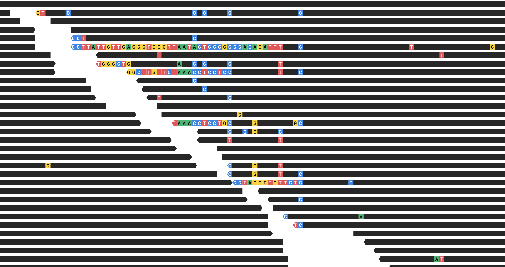

# Named creation during native browsing

Both complete human-reference imports finished while real paired HG002 browsing
continued. All **293 navigation observations wholly inside generation** met their
existing latency expectations. No production regression was exposed. This is a
focused concurrent-workload check; the broader [reference qualification](reference-qualification-2026-11-18.md)
remains a separate historical study.

## Frozen workload and build

The [protocol](reference-creation-protocol-2026-11-21.md) and
[native driver](../../Benchmarks/ReferenceQualification/Concurrent/main.swift)
were committed before timing at `75575a2bc20e060f255c362a8240e4d1c346cff5`.
The product code was unchanged from the completed #73 baseline `4757784`.
Release executables ran on Apple M4, 16 GiB, internal APFS, macOS 27.2.1
(26B131), Xcode 27.2 / Swift 6.4.2, HTSlib 1.25 and system SQLite. Each trial
used a fresh process, 1,100 × 720-point light native window at 2× backing scale,
default prefetch and sampling seed 42. No build or test ran during collection.

The full NCBI GRCh38 no-alt plus hs38d1 FASTA contains 3,105,715,063 bases in
2,580 contigs. Its FASTA/FAI and the derived approximately 100× HG002 BAM/BAI
matched the protocol's existing SHA-256 pins. The native route alternated two
ordinary chr20 loci, typed 100-base intervals, and activated pan right/left and
zoom out/in through native controls with 100 ms between actions. It checked
exact expected coordinates and loaded reference/alignment data after every
timed rasterization. Import ran unthrottled through the actual creation form
and native Save approval boundary. Native progress samples demonstrated overlap.

Input checksumming warmed the uncontrolled OS cache. Trial 1 selected a newly
created named v2 setup bundle; trial 2 selected trial 1's independently verified
output. Only the generated setup bundle was removed after hashing, to bound
disk usage. Both measured outputs and the original historical v1 data remain.

## Completion and memory

| Observation | Trial 1 | Trial 2 |
| --- | ---: | ---: |
| Creation through publication and quiet closure | 20.167 s | 19.915 s |
| Native navigation observations | 150 | 150 |
| Wholly overlapping generation | 148 | 145 |
| Combined process peak RSS | 233.734 MiB | 232.250 MiB |
| Peak sampled physical footprint | 160.814 MiB | 159.704 MiB |
| Memory observations | 78 | 79 |
| Closed bundle bytes | 3,131,998,208 | 3,131,998,208 |
| Bytes per input base | 1.008463 | 1.008463 |
| Validated-open p95, 102 fresh handles | 1.636 ms | 1.650 ms |

Creation closed quietly, preserved the selected BAM/reference and final browsed
interval, and left the output unopened. Both outputs stored **Concurrent GRCh38
qualification**, independently of their filenames. The separate probe checked
all 2,580 ordered name/length/M5 descriptors on every handle and all 204 first
and 204 repeated sequence reads against the independently regenerated FAI oracle.
The output hashes, executable/protocol hashes and raw-file hashes appear in the
[summary](data/reference-creation/summary.json).

The larger of `getrusage` and Darwin `time -l` supplies peak RSS. Both combined
viewer/importer peaks are below the existing 2 GiB viewer ceiling. The earlier
256 MiB isolated-creator gate does not govern a combined workload. Creation times
are below the earlier 60-second isolated-save reference; that comparison is
context, not a newly approved concurrent-import limit. The two finite imports
do not establish ten-minute stability or a universal memory bound.

## Responsiveness

Every group met the existing 95% rule; in fact every fully overlapping action
met its limit. Nearest-rank p95 values below retain separate trial/action groups.

| Native action | Trial 1 count / p95 | Trial 2 count / p95 | Existing limit |
| --- | ---: | ---: | ---: |
| Pan left | 30 / 69.81 ms | 29 / 45.07 ms | 100 ms |
| Pan right | 30 / 68.76 ms | 29 / 68.28 ms | 100 ms |
| Zoom in | 29 / 53.12 ms | 29 / 42.71 ms | 100 ms |
| Zoom out | 29 / 69.81 ms | 29 / 43.36 ms | 100 ms |
| Type A, no required BAM query | 15 / 73.28 ms | 15 / 46.61 ms | 100 ms |
| Type B, no required BAM query | 14 / 72.13 ms | 13 / 73.00 ms | 100 ms |
| First type B, required BAM query | 1 / 16.92 ms | 1 / 16.27 ms | 500 ms |

Maximum query-free latency was 73.28 ms and 80.22 ms, respectively. The two
single required-load observations are reported as individual observations, not
a distribution of fresh-load performance. Seven additional actions finished
the last route cycles at or after creation completion; they remain in raw data
and are excluded from the concurrent groups. The route measures actual input
handlers, required readiness and synchronous native CPU raster of the ruler,
reference and alignments. It excludes OS input delivery, compositor and physical
display latency. No drag, scroll, dense-pileup or cold-cache timing claim follows.

The final track captures were encoded after creation. They show the same native
renderer used in the timing boundary; they are supplementary visual evidence,
not an independent pixel oracle for every navigation.




## Audit and limitations

[Trial 1 observations](data/reference-creation/trial-1.json) and
[trial 2 observations](data/reference-creation/trial-2.json) preserve every
navigation, progress value, coordinate, loaded-data count and memory sample.
Their [first](data/reference-creation/trial-1-probe.json) and
[second](data/reference-creation/trial-2-probe.json) probe records retain all 204
validated-open timings. Darwin resource logs are retained alongside them.
The [evaluator](../../Benchmarks/ReferenceQualification/concurrent.py) reproduces
the timing and memory summaries:

```sh
python3 Benchmarks/ReferenceQualification/concurrent.py "$out/trial-1" "$out/trial-2"
```

Raw native stdout, environment, setup hash, both full outputs and oracle are
also retained in the issue worktree's `.local/measurements/issue-74/`.
This focused check found no missed expectation and required no product repair,
baseline comparator or broader performance investigation. Reference-only
concurrency, cancellation/error retry, source changes, alias protection,
close/quit cleanup and publication races are covered by the separate
[native acceptance evidence](../reference-creation-acceptance.md), not inferred
from these successful paired runs. Automated Save approval does not manually
click the external system Replace button.

A subsequent review improved the measurement harness's failure reporting: an
unsuccessful run retains accumulated observations, the failing action/phase and
the original diagnostic with `completed: false`. A deliberately malformed
synthetic FASTA exercised that path: exit 1, six navigation observations and
four memory samples retained, no output bundle left. This harness check is
not a failed human-reference trial or a product regression. The two successful
measurements above remain pinned to their original executable and protocol.
