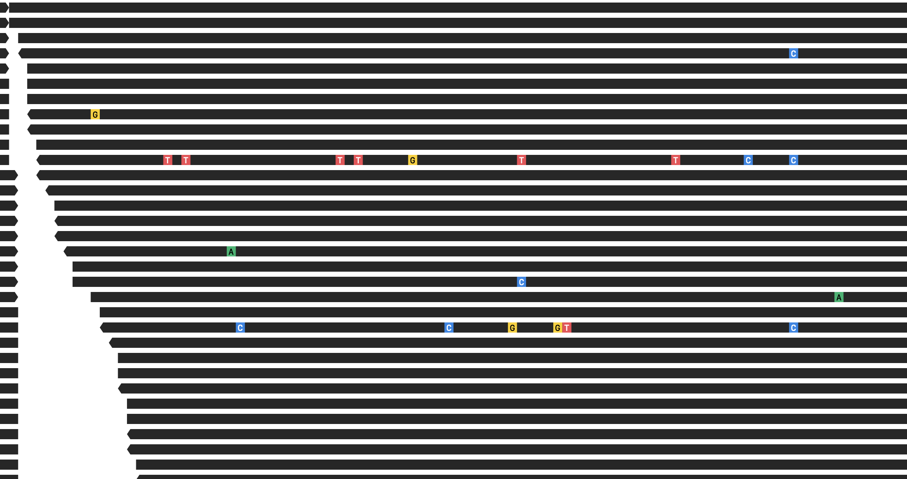

# Native reference milestone qualification

All **78 native viewer cases** completed on the corrected release. Each of the 188 case/action/limit groups and all 17 separately evaluated sustained-route anchor/detail groups met the frozen 95% threshold. Peak process RSS stayed below 2 GiB in every case. Three of 120 paired original-dense 10 kb drag updates exceeded 33 ms; its p95 was 30.93 ms. The [case results](data/reference-qualification/cases.csv) and [action results](data/reference-qualification/timing.csv) retain the individual counts and maxima.

## Native browsing

In the table, the ordinary panel is derived approximately 100× HG002 and the dense panel uses the original nominal 300× HG002 source. Each fresh-load group has 20 fresh sessions. Each drag and scroll group has 120 actual visual updates. Numbers are nearest-rank p95 in milliseconds with the reference selected.

| HG002 source | Visible span | Fresh load | Drag preview | Vertical scroll |
| --- | ---: | ---: | ---: | ---: |
| Ordinary A | 100 bases, letters | 23.18 | 7.93 | 10.41 |
| Ordinary A | 1 kb, cells | 28.11 | 9.37 | 8.62 |
| Ordinary A | 10 kb, alignment geometry | 42.52 | 14.31 | 8.31 |
| Original dense | 100 bases, letters | 53.95 | 7.78 | 10.17 |
| Original dense | 1 kb, cells | 73.46 | 12.14 | 8.66 |
| Original dense | 10 kb, alignment geometry | 104.61 | 30.93 | 8.26 |

All 77 timing groups across the 32 paired cases passed. Cached original-dense paired toolbar pan and zoom p95 ranged from 20.61 to 32.10 ms against the 100 ms limit. The 37 BAM-only cases passed all 86 groups, including 20/20 fresh loads of the synthetic 10,000-alignment single-group fixture (p95 578.62 ms against its 1,000 ms limit). The nine standalone-reference cases passed all 25 groups; their highest typed-navigation group p95 was 26.81 ms and highest drag p95 was 7.62 ms. The standalone viewer issued zero BAM queries. The [full CSV](data/reference-qualification/timing.csv) also covers ordinary B, derived dense, rolling reversals and native transitions.

Independent replay of all 26,459 recorded events checked input order and genomic positions. The largest effective position error was 5.69 × 10⁻¹⁴ bases. Exactly 25,990 events were timed, including every memory-route anchor. Timing includes native input handling, required data readiness and synchronous CPU rasterization of visible tracks at the actual backing scale. OS event delivery and physical display presentation are outside this boundary.

## Active ten-minute routes

| Sources | Active seconds | Cycles | Route steps | Peak RSS (MiB) | Peak sampled physical footprint (MiB) |
| --- | ---: | ---: | ---: | ---: | ---: |
| BAM and reference | 604.886 | 60 | 6,360 | 272.813 | 382.673 |
| BAM only | 604.804 | 60 | 6,360 | 263.344 | 318.111 |
| Reference only | 603.883 | 62 | 6,448 | 149.906 | 197.798 |

The 250 ms sampler produced 2,355, 2,354 and 2,334 observations respectively, including warmup. The peak RSS gate uses the larger of the native process lifetime high-water mark and Darwin `time -l`. Physical footprint is a separate macOS metric. The finite runs show the measured ranges during repeated pans, evictions, reversals and detail loads. The [per-minute ranges](data/reference-qualification/memory-by-minute.csv) and [per-detail timings](data/reference-qualification/memory-detail.csv) preserve those observations. Hardware, OS cache, source depth, screen scale and finite duration bound these results.

## Native sequence and source lifecycle

All six first detailed WGS captures matched the literal, case-preserved FASTA and displayed the independently expected colors at the aligned positions. All **4,200 reference cells, 1,578 eligible visible mismatches, and 1,039 quiet matching-base controls** passed the frozen pixel rules. Geometry excluded 39 visible mismatch probes and 35 quiet controls; another 44 mismatch probes fell near aligned-segment ends. At letter zoom the ordinary panel showed C→T at chr20:10,000,080 and the original dense panel showed C→A at chr20:29,892,193. At cell zoom A→G was visible at chr20:10,025,075 in ordinary A and chr20:29,892,295 in original dense. [Per-case evidence and native capture hashes](data/reference-qualification/pixels.json)




The native Save integration used one window from creating a safely replaced destination through deletion of the source FASTA, opening the bundle via its File menu, attaching a BAM and verifying an actual colored mismatch. Other guarded cases exercised real panel presentation/cancellation, mid-import cancellation with and without a BAM, alias/rename protection, safe failure, no-reference startup, short/long names at both 640 and 1,100 points, fixed reference-row alignment while scrolling, compatibility in both loading orders, and first/subsequent/stale region failures. The guarded source/lifecycle run completed 48 tests in nine suites in 8.327 s. The focused cache, visibility, continuity and sampling run after repairs completed 36 tests in six suites in 1.109 s. The successful replacement test supplied the system-approved URL at the native Save-panel delegate boundary. macOS owned the external confirmation button; the test did not click that button manually.

## Human-reference creation and opening

On the M4 with 16 GiB and internal APFS storage, all four limits passed for both release-mode saves at `b4c473ab6bacd63e74de2e034c6cbc4a5f05a841`. Each save started in a fresh, empty native window. The elapsed time includes modal progress through completed publication and sheet dismissal. The RSS maximum covers the entire creator process. [Frozen storage protocol](reference-storage-protocol-56.md) · [All 204 validated-open timings and bundle hashes](data/reference-qualification/storage.json)

| Observation | Build 1 | Build 2 | Limit per build |
| --- | ---: | ---: | ---: |
| Native Save | 23.068 s | 21.169 s | ≤60 s |
| Creator peak RSS | 168.266 MiB | 162.438 MiB | ≤256 MiB |
| Closed bytes | 3,131,998,208 | 3,131,998,208 | — |
| Bytes per input base | 1.008463 | 1.008463 | ≤1.05 |
| Validated open p95 (102 fresh handles) | 1.586 ms | 1.558 ms | ≤50 ms |

On each handle, all 2,580 descriptors matched the publisher's ordered dictionary, and the first and repeated interval read matched independent FAI-derived bytes. The uncompressed FASTA contained 3,105,715,063 bases. Fresh handles opened newly created files in an unflushed OS cache. Timed opening includes validation, and ends before the independent dictionary comparisons and region reads. The viewer routes used build 1, SHA-256 `1f8c9c6e5f1b155fd3b743338d565484b76703cec43d6e578b5eb35443f469eb`.

The actual host ran macOS 27.2.1 (26B131), Xcode 27.2 (27B52), Swift 6.4.2 and platform SQLite 3.54.0. The archive recorded static HTSlib 1.25 SHA-256 `879913b15587861b7ac738c74b1eb2d3375dca367e3a868c5755efe950343619`, native storage executable `cebed2b6f9bce3cf2db632bdfb6ba078b728f3f4f0b6cf6368a4c1c882c3369b` and native viewer measurement executable `b4a6080cda96f37426783e615d5be14ead8b742265f03f5e9639b927d843d782`. Measurement used a 1,100 × 720-point native window at 2× backing scale. The final release app built from the same source.

## Failures found during qualification

The [integrated protocol](reference-qualification-protocol-2026-11-18.md), input oracles and acceptance rules were committed at `2feb8f349742d03c3dd610f0db047dc6e121524b` before the first timed save. The original two saves also passed at 22.111/22.817 s, 169.016/167.078 MiB RSS, the same closed size, and open p95 1.738/1.792 ms. Their complete outputs remain in `.local/measurements/issue-56/storage-baseline-2feb8f3/`. Two subsequent viewer findings prompted production changes.

1. The first 25 viewer cases passed 46 timing groups. The original-dense BAM-only cached route then stopped because zooming back to 2 kb issued a required query. The initial 10 kb query returned 48,911 records. After narrowing, one large optional flank containing distant records was evicted as a unit, losing nearby complete coverage. A real-BAM session regression reproduced this with a smaller cache. Under pressure the cache now splits such optional flanks into the configured chunk size before evicting the most distant ones. Alignment records spanning a boundary count toward each retained chunk. Both paired and BAM-only cached dense replays succeeded at `5ae7290`.
2. At `5ae7290` just 27 of 120 paired original-dense 10 kb drag updates met 33 ms (p95 34.57 ms). A separate two-second native profile attributed 423 of 747 input-handler samples to selection and 197 to candidate retrieval/filtering. On every preview the old path copied complete retained arrays before computing drawn overlap. The new path filters records by required aligned overlap and visible drawn overlap in one pass over the cache and computes segment extrema without intermediate arrays. All 120 paired intervals, selection hashes, alignment/row counts and retained-row checks matched the failing run exactly. Focused replays gave 119/120 at p95 29.59 ms paired and 120/120 at 29.20 ms BAM only. The record and optional-byte limits, sampling identity and timing criteria stayed fixed.

## How to audit a reproduction

Complete the [frozen viewer route](reference-qualification-protocol-2026-11-18.md#reproduction). Check the SHA-256 of the viewer's `build-1.bref` against trial 1 in the storage results produced by that reproduction. The bundle creation timestamp is stored in its provenance, so a fresh creation receives its own hash. The viewer archive records the exact input hash it used. The source-mode cases also record which sources were actually selected.

The original native `environment.json` scope string inherited an alignment/ruler-only track description. In the measured [driver](../../Benchmarks/PrefetchQualification/main.swift), `Workspace.draw` rasterized the actual selected reference row too, inside the timed boundary, and the first detailed load captures contain its independent bitmap. The whole-window capture serves as supplementary context.

The corrected native run, snapshots, per-case raw timings, per-event coordinates, query traces and PNGs are retained locally in `.local/measurements/issue-56/viewer-b4c473a/`. The independent evaluation and full memory traces are in its sibling `evaluated-b4c473a/` and `summary-b4c473a/` directories. The compact [case manifest](data/reference-qualification/cases.csv) pins the raw observation SHA-256 for each case. The original incomplete run and diagnostic replays remain in `viewer-v1/`, `replay-eviction/` and `replay-drag/`. The local full native suite again exited before Swift Testing produced its completion summary, and the unchanged guard rejected that run. Completed full-suite evidence belongs to the supported-toolchain CI run.

The [reference evaluator](../../Benchmarks/ReferenceQualification/evaluate.py) applies the 100 ms limit to **every** observed navigation with no required BAM query and the 33 ms limit to every measured drag or scroll. Three inherited memory-route `anchor` steps omitted their numerical limit. Each receives 500 ms for the ordinary load or 100 ms when query-free. The reference evaluator covers these steps and separately reports the four dedicated detail loads per memory cycle. The original per-mode `samples.jsonl` measurements are preserved. Run the [pixel evaluator](../../Benchmarks/ReferenceQualification/oracle-audit.py) against the same first detailed captures and the independently regenerated oracle.

```sh
shasum -a 256 .local/measurements/issue-56/storage/build-1.bref
python3 Benchmarks/ReferenceQualification/evaluate.py .local/reference-protocol-v1.json .local/reference-results .local/reference-evaluation
python3 Benchmarks/ReferenceQualification/oracle-audit.py .local/reference-results .local/oracle-reproduction > .local/reference-pixel-audit.json
```
